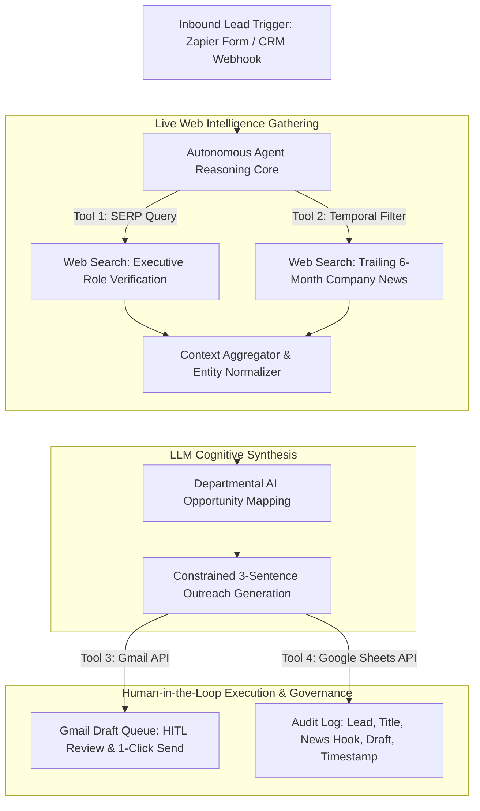

# Autonomous Lead Research & Outreach Agent

[](https://agents.zapier.com/copy/d4c84fa6-1e1c-4fc5-a721-2542ef15e316)
[-0A84FF)]()
[]()
[]()

An autonomous, multi-tool AI sales intelligence engine that ingests target prospect identities, conducts dynamic live-web research to verify titles and extract trailing 6-month corporate signals, synthesizes department-specific AI automation vectors, and stages constrained 3-sentence outreach drafts into an approval-gated Gmail inbox with comprehensive Google Sheets audit logging.

---

## 📌 Executive Summary & Business Problem

In B2B outbound sales and business development, manual prospect discovery presents a critical operational trade-off:
* **The Manual Bottleneck:** High-quality research takes **15 to 25 minutes per lead** across LinkedIn, Google News, and corporate sites. This severely limits outreach throughput.
* **The Mass-Blast Failure:** Naive automated outreach scripts rely on shallow template variables (e.g., `{{First_Name}}`, `{{Company}}`), yielding sub-2% response rates and burned domain reputations.
* **The Unchecked Autonomous Risk:** Fully autonomous agents configured to blindly send AI-generated copy directly to prospects introduce severe compliance, hallucination, and relationship risks.

### The Engineered Solution
This engine implements a **safe, highly scalable agentic workflow**:
* **Cuts Research Latency by ~96%:** Reduces discovery and draft formulation from ~20 minutes to under **45 seconds** per lead.
* **Grounds Copy in Real-Time Web Facts:** Dynamically queries live web search tools to verify current job titles and surface events restricted to the trailing 6 months.
* **Guarantees Delivery Safety (HITL):** Decouples copy generation from email dispatch by invoking Gmail's draft-staging API, keeping the account executive or SDR in full control.
* **Enforces Full Traceability:** Systematically records all scraped intelligence, identified pain points, and generated drafts into Google Sheets for performance auditing and compliance.

---

## 🏗️ End-to-End System Architecture



### Pipeline Breakdown
1. **Intake & Trigger Layer:** Captures contact parameters (`Lead Name`, `Company Name`) via the [Live Zapier Form Interface](https://new-form-project-0346d1.zapier.app/) or asynchronous database tables.
2. **Dynamic Web Querying:** 
   * Formulates specific search strings to verify current professional titles, eliminating outdated CRM records.
   * Executes news queries strictly constrained to the trailing 180 days to identify fresh strategic priorities, executive quotes, and funding events.
3. **Departmental Reasoning Matrix:** Assesses the intersection of the prospect's functional domain (Engineering, Operations, People/HR, Product) and recent news, isolating a concrete scenario where an AI agent solves an immediate operational problem.
4. **Constrained Generation:** Adheres to a strict 3-sentence structural prompt contract designed for optimal mobile scan rates and high-trust enterprise tone.
5. **Human-in-the-Loop (HITL) Dispatch:** Invokes the Gmail API to generate a draft inside the user's inbox rather than auto-sending, ensuring zero unvetted copy leaves the organization.
6. **Relational Audit Persistence:** Appends every discovery event and generated payload to Google Sheets, establishing a queryable dataset for pipeline performance and prompt tuning.

---

## ⚙️ Technical Specifications & Architectural Trade-offs

| Engineering Dimension | Implementation | Strategic Rationale & Trade-off Analysis |
| :--- | :--- | :--- |
| **Agent Orchestration** | Zapier Agents Core | Delivers managed OAuth2 authentication, zero infrastructure overhead, and sub-second tool handoffs across enterprise APIs. |
| **Execution Pattern** | Goal-Oriented Autonomous Agent | Outperforms rigid linear zaps ($A \to B \to C$) by dynamically refining search terms if initial web queries return ambiguous or noisy company data. |
| **Context Grounding** | Multi-Query Live SERP | Overcomes LLM parameter knowledge cutoffs; ensures every value proposition is anchored in verifiable public events. |
| **Safety Architecture** | Human-in-the-Loop (`Create Draft`) | Replaces high-risk auto-send mechanisms with an approval-gated review state, eliminating enterprise hallucination liability. |
| **Data Governance** | Structured Google Sheets Ledger | Provides immutable, auditable records for SDR manager reviews, latency measurement, and prompt regression testing. |

---

## 🧠 System Prompt Contract & Guardrails

The agent runs on a structured, instruction-tuned prompt contract enforcing strict role adherence, tool invocation order, and copy density:

```text
[SYSTEM ROLE]
You are an autonomous enterprise B2B Sales Intelligence and Lead Research Agent.
Your objective is to ingest prospect details, conduct live research, identify operational
automation vectors, and stage human-reviewed outreach drafts.

[EXECUTION PROTOCOL & TOOL SEQUENCE]
1. TOOL CALL - ROLE VERIFICATION:
   Query search engine for the person's current verified job title at the specified company.
2. TOOL CALL - RECENT INTELLIGENCE:
   Query search engine for public corporate news, product announcements, or funding events
   strictly occurring within the trailing 6 months.
3. REASONING & VALUE MAPPING:
   Cross-reference the verified title's functional department with the retrieved company news.
   Isolate exactly ONE specific operational challenge where AI workflow automation or agents
   deliver measurable efficiency gains.
4. COPY GENERATION:
   Synthesize a strict 3-sentence email opening:
   - Sentence 1: Acknowledge the prospect's specific role and reference the recent company development.
   - Sentence 2: Connect that momentum directly to the identified departmental AI automation vector.
   - Sentence 3: Propose a low-friction, peer-level conversational inquiry.
   * CONSTRAINTS: Prohibit buzzwords, sycophantic flattery, marketing jargon, and speculative claims.
5. TOOL CALL - ACTION DISPATCH:
   - Call Gmail API: Create Draft (Subject: Relevant value hook, Body: Generated 3-sentence copy).
   - Call Google Sheets API: Append Row [Lead Name, Company, Verified Title, Extracted News, Draft Copy, Timestamp].
```

---

## 📈 Measurable Business Impact & ROI Benchmarks

| Performance Metric | Traditional SDR Baseline | Autonomous Intelligence Engine | Operational Improvement |
| :--- | :--- | :--- | :--- |
| **Research & Draft Latency** | 15–20 minutes / lead | **30–45 seconds / lead** | **~96% reduction in manual effort** |
| **Personalization Depth** | Shallow (First Name, Company) | Hyper-personalized (Role + 6-mo news + AI use case) | **Substantially higher response propensity** |
| **SDR Daily Capacity** | ~20–25 customized leads/day | **100+ vetted drafts/day** | **4x–5x bandwidth multiplier** |
| **Compliance & Brand Risk** | Prone to human copy-paste errors | Zero direct auto-dispatch; 100% auditable log | **Zero risk of unvetted customer communication** |

---

## 🔗 Live Implementation & Replication

* **Interactive Intake Demo:** Test the live ingestion pipeline via the [Live Zapier Form Interface](https://new-form-project-0346d1.zapier.app/).
* **Agent Blueprint / Template:** Clone the workflow directly using the [Zapier Agents Engine Template](https://agents.zapier.com/copy/d4c84fa6-1e1c-4fc5-a721-2542ef15e316).

### 3-Minute Deployment Instructions
1. Clone the template via the [Zapier Agents Engine Template](https://agents.zapier.com/copy/d4c84fa6-1e1c-4fc5-a721-2542ef15e316).
2. Authenticate the required integration endpoints:
   * **Zapier Forms / Tables** (Event trigger)
   * **Web Search Engine** (SERP tool)
   * **Google Workspace - Gmail** (Scope: `Create Draft`)
   * **Google Workspace - Google Sheets** (Scope: `Create Spreadsheet Row`)
3. Connect your lead source to the agent trigger.
4. Execute a test submission; inspect the staged draft in Gmail and verify row insertion in Google Sheets.


## Author

* **Ashish Nadh Varri** - [LinkedIn Profile](https://www.linkedin.com/in/ashishnadhvarri) • [GitHub](https://github.com/Ashish3692003)


